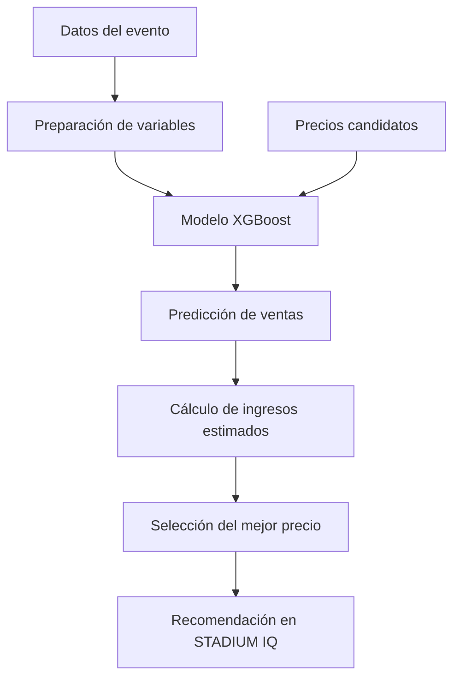
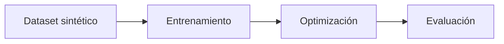

<div align="center">

# 🏟️ STADIUM IQ

### Smart Stadium Pricing

**Intelligent Demand Forecasting & Dynamic Ticket Pricing**

Plataforma de inteligencia artificial para predecir la demanda de entradas deportivas, recomendar precios y evaluar estrategias de pricing.

<br>


<br>

**[Funcionalidades](#-funcionalidades)** ·
**[Resultados](#-resultados-experimentales)** ·
**[Instalación](#-instalación-y-ejecución)** ·
**[Metodología](#-metodología)**

</div>

---

## 💡 El proyecto

### ¿Cuál es el precio adecuado para una entrada deportiva?

Un precio demasiado bajo puede desaprovechar oportunidades de ingresos. Uno demasiado elevado puede reducir la demanda y dejar entradas sin vender.

Además, la decisión depende de factores como:

- El interés y la importancia del evento.
- Los días que faltan hasta su celebración.
- La disponibilidad de entradas.
- El precio actual y el rango permitido.
- Las características del deporte y la categoría de entrada.

**STADIUM IQ** estudia este problema mediante Machine Learning, optimización y simulación.

El sistema utiliza XGBoost para predecir ventas y analizar diferentes precios candidatos, con el objetivo de recomendar el precio que genera mayores ingresos estimados durante el siguiente período comercial.

> [!NOTE]
> Este es un proyecto académico desarrollado con datos sintéticos. Las recomendaciones no se han validado en mercados reales.

---

## 📊 STADIUM IQ en cifras

| Dataset | Modelo | Evaluación |
|:---:|:---:|:---:|
| **120 eventos** | **XGBoost** | **24 eventos de prueba** |
| **4 deportes** | Predicción de demanda | **48 categorías** |
| **7.200 registros** | Optimización de ingresos | **20 repeticiones** |

### Deportes compatibles

| ⚽ Fútbol | 🏀 Baloncesto | 🎾 Tenis | 🏃 Running |
|:---:|:---:|:---:|:---:|
| Eventos futbolísticos | Competiciones de baloncesto | Eventos de tenis | Eventos de running |

---

## 🖥️ Funcionalidades

La plataforma contiene cuatro secciones principales.

### 01 — Inicio

Presentación general del proyecto y acceso a las diferentes herramientas de STADIUM IQ.

### 02 — Simulador de precios

La funcionalidad principal de la plataforma.

Permite:

- Seleccionar un deporte y un evento.
- Configurar la categoría de entrada.
- Elegir los días restantes hasta el evento.
- Modificar el inventario y explorar escenarios hipotéticos.
- Obtener recomendaciones de precios mediante XGBoost.
- Comparar los ingresos previstos con el precio actual y el recomendado.
- Visualizar curvas de precio, demanda e ingresos.

El precio recomendado maximiza los ingresos **estimados para el siguiente período comercial** dentro del rango evaluado.

### 03 — Simulador original

Primer prototipo del proyecto, centrado en el fútbol.

Se mantiene para mostrar la evolución de STADIUM IQ desde el enfoque inicial hasta la herramienta multideporte.

### 04 — Resultados y validación

Panel de análisis experimental que permite consultar:

- Mejora media de ingresos simulados.
- Resultados por deporte.
- Estabilidad entre repeticiones.
- Evolución de ingresos acumulados.
- Comparación del inventario restante.
- Situaciones con entradas agotadas.

---

## 🧠 ¿Cómo funciona?



### Predicción de demanda

El sistema utiliza dos enfoques:

| Modelo | Predicción |
|---|---|
| **Directo** | Número estimado de entradas vendidas durante el siguiente período |
| **Tasa de ventas** | Proporción estimada del inventario que se venderá |

El modelo de tasa de ventas se utiliza por defecto en el simulador multideporte.

### Optimización de precios

Para cada precio candidato:

1. Se calculan las características del escenario.
2. XGBoost predice la demanda.
3. Se limita la cantidad prevista al inventario disponible.
4. Se calculan los ingresos estimados.
5. Se selecciona el precio con el mayor resultado.

La función objetivo es:

$$
R(p) = p \cdot \hat{D}(p)
$$

Donde:

- $p$: precio de la entrada.
- $\hat{D}(p)$: demanda estimada por el modelo para ese precio.
- $R(p)$: ingresos previstos.

El modelo predictivo es una aproximación aprendida a partir de datos sintéticos, no una estimación causal demostrada de elasticidad-precio.

---

## 📈 Resultados experimentales

Para evaluar la estrategia de Dynamic Pricing se compararon dos políticas:

| Política | Descripción |
|---|---|
| **Precio fijo** | Mantiene un precio de referencia durante el período de venta |
| **Precio dinámico** | Recalcula diariamente el precio recomendado mediante XGBoost |

La evaluación utiliza el generador sintético de demanda para producir las ventas, en lugar de utilizar directamente las predicciones de XGBoost como resultados.

### Resultados principales

<div align="center">

### +13,96 %

**Mejora media de ingresos simulados**

**20 / 20** repeticiones con mejora global

**24** eventos de evaluación · **48** categorías

</div>

Los resultados corresponden a la evaluación experimental con condiciones aleatorias compartidas entre las dos políticas.

### Diseño del experimento

- **96 eventos** utilizados para entrenar.
- **24 eventos** reservados para evaluación.
- **48 categorías** de entradas.
- **20 repeticiones** con diferentes condiciones aleatorias.
- Comparación de políticas bajo factores aleatorios compartidos.
- Modelo XGBoost y partición de eventos fijos entre repeticiones.

La estrategia dinámica obtuvo mayores ingresos simulados que la estrategia fija en las 20 repeticiones del experimento.

### Interpretación

Los resultados son prometedores dentro del entorno sintético utilizado.

Sin embargo, **no demuestran un incremento real del 13,96 % en ingresos comerciales**.

La mejora depende del generador de demanda, de los supuestos del experimento y de los eventos evaluados.

Los resultados completos se encuentran en:

`frontend/public/validation/`

---

## 🔬 Metodología

El proyecto sigue cuatro etapas:



### 1. Preparación de datos

Se utiliza un dataset sintético de eventos deportivos, categorías y observaciones temporales.

Archivo principal:

`dataset_multideporte_EQUIPO.csv`

Generador de datos:

`generar_dataset.py`

### 2. Entrenamiento

Se entrenan modelos XGBoost utilizando las características del evento, el inventario y otras variables de demanda.

Se separan los datos por evento para evitar mezclar observaciones temporales del mismo evento entre entrenamiento y evaluación.

Código principal:

`multisport_v7.py`

### 3. Optimización

El algoritmo evalúa precios candidatos y escoge el que produce los mayores ingresos previstos durante el siguiente período comercial.

### 4. Validación

Se simula la evolución de ventas e inventario bajo estrategias de precio fijo y dinámico.

La evaluación utiliza factores aleatorios compartidos para mejorar la comparabilidad entre políticas.

Código:

`v8_2_validacion.py`

---

## 🛠️ Tecnologías

| Capa | Tecnologías |
|---|---|
| Machine Learning | Python, XGBoost, scikit-learn |
| Procesamiento de datos | pandas, NumPy |
| Simulación estadística | SciPy |
| Backend | FastAPI, Uvicorn |
| Frontend | React, Vite |
| Visualización | Recharts |
| Versionado | Git, GitHub |

---

## 🚀 Instalación y ejecución

### Requisitos previos

- Python 3.10 o superior, con dependencias compatibles.
- Node.js y npm.
- Git.
- Git LFS para descargar correctamente los archivos grandes del repositorio.

### 1. Clonar el repositorio

```bash
git clone https://github.com/Llarkruks/PAE_DynamicPricing.git
cd PAE_DynamicPricing
git lfs pull
```

### 2. Crear el entorno virtual

En Windows PowerShell:

```powershell
python -m venv .venv
.\.venv\Scripts\Activate.ps1
```

Si PowerShell bloquea la activación:

```powershell
Set-ExecutionPolicy -Scope Process -ExecutionPolicy RemoteSigned
.\.venv\Scripts\Activate.ps1
```

### 3. Instalar dependencias Python

```powershell
python -m pip install -r requirements.txt
```

### 4. Instalar el frontend

```powershell
cd frontend
npm ci
cd ..
```

---

## ▶️ Iniciar STADIUM IQ

La aplicación utiliza tres servicios que deben ejecutarse simultáneamente.

### Terminal 1 — Backend del simulador original

Desde la raíz del proyecto:

```powershell
python -m uvicorn main:app --reload --port 8000
```

### Terminal 2 — Backend multideporte

Desde la raíz del proyecto:

```powershell
python -m uvicorn api_multisport_v7:app --reload --port 8001
```

### Terminal 3 — Frontend

```powershell
cd frontend
npm run dev
```

Abre la plataforma en:

**http://localhost:5173/**

### Navegación

| Página | Ruta |
|---|---|
| Inicio | `/` |
| Simulador de precios | `/multisport` |
| Simulador original | `/simulator` |
| Resultados y validación | `/validation` |

---

## 📁 Estructura del repositorio

```text
PAE_DynamicPricing/
│
├── frontend/
│   ├── public/
│   │   └── validation/
│   └── src/
│       ├── App.jsx
│       ├── Sidebar.jsx
│       └── pages/
│           ├── Dashboard.jsx
│           ├── Simulator.jsx
│           ├── Multisport.jsx
│           └── Validation.jsx
│
├── main.py
├── pricing_optimizer.py
├── data_loader.py
├── train_model.py
│
├── api_multisport_v7.py
├── multisport_v7.py
├── multisport_v7_model.joblib
├── multisport_v7_metrics.json
│
├── dataset_multideporte_EQUIPO.csv
├── generar_dataset.py
│
├── validate_v7.py
├── v7_8_evaluacion.py
├── v8_2_validacion.py
│
├── requirements.txt
└── README.md
```

Los nombres de versión conservados en determinados archivos Python corresponden a la evolución interna del proyecto. La interfaz presenta las funcionalidades con nombres definitivos.

---

## 🔁 Reproducir los resultados

Los comandos se ejecutan desde la raíz del proyecto, con el entorno virtual activado.

### Entrenamiento multideporte

```powershell
python multisport_v7.py train
```

### Validación predictiva

```powershell
python validate_v7.py
```

### Evaluación de estrategias

```powershell
python v8_2_validacion.py --repeticiones 20
```

El último comando genera:

- `v8_2_resumen.json`
- `v8_2_repeticiones.csv`
- `v8_2_deportes.csv`
- `v8_2_detalle.csv`

Para actualizar los resultados que muestra la aplicación, copia los archivos de resumen, repeticiones y detalle a:

`frontend/public/validation/`

---

## ⚠️ Limitaciones

STADIUM IQ es un prototipo académico y debe interpretarse dentro de su alcance experimental.

**Datos sintéticos:** no se han utilizado transacciones reales de consumidores para demostrar el rendimiento comercial.

**Elasticidad-precio:** el modelo predice demanda a diferentes precios, pero esto no equivale a identificar causalmente cómo responderían los compradores ante cambios reales de precio.

**Validación limitada:** las repeticiones mantienen un mismo modelo y conjunto de eventos de prueba. Permiten estudiar la variabilidad del simulador, pero no garantizan generalización.

**Optimización diaria:** la política dinámica evalúa el mejor precio estimado para cada día. No resuelve todavía la optimización conjunta de los ingresos de todo el horizonte de venta.

**Entorno simulado:** los resultados dependen de los supuestos de la función sintética de demanda.

---

## 🔭 Próximos pasos

- Evaluar con múltiples particiones independientes de eventos.
- Integrar datos reales de venta de entradas.
- Estudiar métodos de estimación causal de la sensibilidad al precio.
- Incorporar políticas de optimización multiperíodo.
- Añadir restricciones comerciales y reglas de negocio.
- Evaluar el sistema en un entorno más representativo de operaciones reales.

---

<div align="center">

### 🏟️ STADIUM IQ

**From Demand Prediction to Smarter Pricing Decisions**

Proyecto académico PAE · Smart Stadium Pricing

*Machine Learning · Revenue Optimization · Sports Analytics*

</div>
